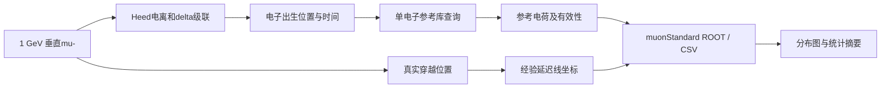

# RPC 模拟程序结构与物理原理说明

更新日期：2026-10-20。对应目录：`D:\muon\PKMUON_2024-HCR`。

本轮新增：`RpcSpatial.hh`与`rpc_digitize --spatial-multi 5`实现用户授权的理想空间多位置读出，同一50 ns组中近中心合并、远中心各输出坐标；5σ=3.745 mm，另扫描3σ/10σ。使用模拟轨迹中心，不代表电子学波形或四端配对已标定。旧拒绝策略保留为对照。
`scripts/response_interpolation.py`实现相邻标准库在log(E)上的完整事例分布凸组合，保留整数电子数与事例相关性；六个标准点留一验证及五个新种子中间能量验证结果见 `results/comparison_20261020/spatial_interpolation/spatial_interpolation_report.html`。只覆盖垂直mu-的能量维度；拒绝能量越界，不把尚未解决的线性总电荷用于完整响应插值。

## 1. 程序目标与当前完成范围

目标是将粒子在RPC中的输运，与气体放大和读出响应分开处理：昂贵的气体计算离线执行，生产模拟使用参数或缓存样本，最终输出测量坐标。

当前已实现“**气体输运表＋单电子线性雪崩参考库＋缪子标准样本＋经验坐标基线**”。其中物理计算、参考近似和实验标定的职责如下。

| 内容 | 当前实现 | 结果的含义 |
|---|---|---|
| 宏观几何、粒子输运、散射与显式次级粒子 | Geant4 | 实际输运轨迹及能量沉积 |
| 气体电子输运系数 | Garfield++/Magboltz | 指定气体、温压、场强下的统计系数 |
| 缪子初级电离及δ电子级联 | 独立Heed样本 | 电离簇、低能电子出生位置和时间 |
| 雪崩增殖、附着与涨落 | 自编线性出生—死亡模型 | 无空间电荷条件下的单电子参考样本 |
| 电荷感应 | 理想平板电子Ramo积分 | 电子部分的参考感应电荷，不是实际条带完整波形 |
| 延迟线坐标 | 名义传播关系＋实测sigma约束的端点抖动 | 孤立命中的经验坐标模型 |
| 阈值、效率、饱和、死时间、多命中配对 | 尚未标定 | 不作定量预测 |

**当前不是Geant4每次入射就在线调用完整Garfield++的程序。** Geant4坐标基线也尚未用单电子库的电荷替换其重心权重。它们是可以分别验证的两条路径，不能把现有结果解释为已经完成了全部物理过程的耦合。

## 2. 目录与模块分工

```text
PKMUON_2024-HCR/
├─ muPos.cc                         Geant4主程序、物理列表及运行入口
├─ CMakeLists.txt                   原Geant4/ROOT项目构建
├─ config/
│  ├─ newrpc_material.yaml          材料组成和原指定密度
│  ├─ newrpc.yaml                   玻璃、电极、气隙等层结构
│  ├─ newrpc_readout.yaml           读出几何
│  ├─ newlayout*.yaml               多层RPC及靶物布局
│  └─ rpc_response.yaml             已确认物理条件和待标定参数清单
├─ include/
│  ├─ RpcSegment.hh                新逐段轨迹数据结构
│  ├─ Run.hh                       运行记录及气隙记录接口
│  └─ Object.hh                    原ROOT事件对象
├─ src/
│  ├─ DetectorConstruction.cc       几何和原场设置
│  ├─ PrimaryGeneratorAction.cc     原Gaisser–Tang源及验证用铅笔束
│  ├─ SteppingAction.cc             将每一步交给Run
│  └─ Run.cc                       ROOT输出、逐段气隙记录及原触发筛选
├─ analysis/                       原分析路径，保留用于兼容
└─ rpc_response/
   ├─ CMakeLists.txt                响应工具的独立构建
   ├─ include/
   │  ├─ RpcResponse.hh             输运参数、雪崩统计、分组和延迟线模型
   │  └─ RpcKernel.hh               ROOT参考库加载与内存抽样
   ├─ src/
   │  ├─ make_gas.cc                rpc_make_gas
   │  ├─ make_response.cc           rpc_make_response
   │  ├─ make_kernel.cc             rpc_make_kernel
   │  ├─ query_kernel.cc            rpc_query_kernel
   │  ├─ make_muon_standard.cc      rpc_make_muon_standard
   │  └─ digitize.cc                rpc_digitize
   ├─ scripts/                     Ubuntu环境、构建、验证与绘图
   ├─ tests/                       物理内核和ROOT链路检查
   └─ results/                     生成的气体表、ROOT/CSV和图表
```

ROOT负责结构化数据保存；CSV用于绘图和快速检查；NumPy/Matplotlib负责统计与图表。虚拟机运行Garfield++和Geant4，Windows与Ubuntu共享项目目录。

注意：`rpc_response.yaml`当前是参数与假设记录，**尚不是所有工具自动读取的统一运行配置**。场强等通过命令行传入；0.749 mm及名义延迟线参数仍在C++实现中显式定义。只修改此YAML不会自动改变全部模拟。

## 3. 三条数据流

### 3.1 离线气体与单电子参考库


`rpc_make_gas`求解多个场强下的输运统计；`rpc_make_response`提取工作点参数并转换单位；`rpc_make_kernel`对不同起始漂移距离抽样雪崩。`RpcKernel`一次加载整份参考库，运行时按最近深度格随机抽取样本。

### 3.2 Geant4坐标基线


默认初级源仍是原Gaisser–Tang生成器。设置`MUPOS_RPC_PENCIL_BEAM=1`时，使用验证专用1 GeV、沿+Z的垂直缪子束，不改变未设置该变量时的生产源。

新`rpcSegments`在原四层触发筛选之前记录真实2 mm气隙内的步，包括零沉积步。逐步记录保留主/次级轨迹身份和时间，避免原`Edeps`按种类与过程合并后丢失信息。

### 3.3 独立缪子标准样本



这里电荷与坐标是并行输出：**坐标不是由未标定的雪崩电荷谱推出来的**。该独立样本的电离全部交给Heed，不叠加Geant4电离。Geant4与Heed的电离职责必须明确，否则同一δ电子贡献可能被重复计算；这也是成熟接口设计关注的问题。[Geant4/Heed接口研究](https://arxiv.org/abs/1806.05880)

## 4. 物理原理与对应代码

### 4.1 入射粒子的电离、散射和次级粒子

Geant4主程序采用`FTFP_BERT`，替换为`G4EmStandardPhysics_option4`电磁模块，并注册步长限制物理。粒子在各材料中逐步输运，可以发生能量损失、散射，并产生被显式跟踪的次级粒子。

有限能量转移不一定都对应一条次级轨迹：低于相应产生阈值的贡献可以进入局部沉积。`edep_ev`是步内总沉积；数字化基线使用

\[
E_{\mathrm{weight}}=E_{\mathrm{dep}}-E_{\mathrm{nonion}}
\]

作为权重。这是经验重心构造，不等于从这些量已经恢复了真实微观电离簇。

独立缪子样本用`TrackHeed`生成初级电离簇，再获得簇内级联产生的低能电子。簇数、簇大小、电子出生深度和δ电子级联都有涨落，不能只用平均能损代表全部响应。

概念上，若可归属于局部电离的能量已知，可用`N≈E/W`估计平均电子数；本次Heed给出W约30.7 eV。但当前缪子标准样本**直接使用Heed生成的电子**，没有用`E/W`替换它们。簇的能量转移之和也不必等于气隙内最终沉积能量，次级粒子可能逃逸。

### 4.2 气体电场和电子输运

首版按用户确认的低计数率直流稳态工作：忽略玻璃压降，将10,100 V视为有效气隙电压。均匀场为

\[
E=\frac{U_{\mathrm{gas}}}{d}
 =\frac{10100\ \mathrm{V}}{0.2\ \mathrm{cm}}
 =50.5\ \mathrm{kV/cm}.
\]

这不是开机瞬态或高计数率下的电阻板恢复模型。2 mm只指气隙，不包含两侧玻璃。这个50.5 kV/cm用于新Garfield++输运工具；原Geant4的`DefineFields`仍是独立配置，尚未改成由同一响应配置统一驱动。

Magboltz计算电子在气体碰撞中的统计输运量：漂移速度v、纵/横扩散系数、Townsend电离系数α和附着系数η。其接口和单位见[Garfield++手册](https://garfieldpp.web.cern.ch/doxygen/UserGuide.pdf)。当前工作点导出值为：

| 参数 | 数值 | 物理含义 |
|---|---:|---|
| v | 0.105727 mm/ns | 电子平均漂移速度的大小 |
| α | 13.59775 /mm | 单位漂移长度的电离增殖系数 |
| η | 0.177720 /mm | 单位漂移长度的电子附着系数 |
| D_L | 0.030179 sqrt(mm) | 纵向扩散宽度系数 |
| D_T | 0.040215 sqrt(mm) | 单横向方向的扩散宽度系数 |

按该扩散系数约定，漂移长度为ℓ时，单方向宽度满足`σ=D√ℓ`。目前扩散参数被保存和绘图，**尚未在单电子线性库中显式抽样空间扩散**。名义电子到达时间为

\[
t_{\mathrm{arrival}}=t_{\mathrm{birth}}+\frac{\ell}{v}.
\]

完整2 mm的漂移时间约18.92 ns；它不是前端的实际过阈时间或RPC时间分辨率。

### 4.3 线性雪崩的出生—死亡统计

实现位置：`RpcResponse.hh`中的`Advance`和`Grow`。

每个电子以系数α产生新电子，以系数η附着消失；忽略雪崩对局部电场的反作用。常系数条件下，平均电子数满足

\[
\frac{d\langle N\rangle}{d\ell}=(\alpha-\eta)\langle N\rangle,
\qquad
\langle N(\ell)\rangle=N_0e^{(\alpha-\eta)\ell}.
\]

程序没有把平均值当作每次事件的实际增益，而是抽样涨落。对一个步长Δℓ，令r=α−η，当r≠0时定义

\[
p_0=\frac{\eta(1-e^{-r\Delta\ell})}{\alpha-\eta e^{-r\Delta\ell}},
\qquad
q=\frac{\alpha(1-e^{-r\Delta\ell})}{\alpha-\eta e^{-r\Delta\ell}}.
\]

一个起始电子的后代数满足`P(N=0)=p0`；在N≥1时为带存活权重的几何分布。程序先抽样存活家族数，再用负二项分布求这些几何家族的总人口，因此无需逐个追踪数百万个电子。当α=η时使用对应极限，避免数值相消。

这是**常系数线性过程的精确人口转移抽样**，不意味着完整RPC物理已精确求解。感应积分仍按离散步近似；空间电荷、离子慢尾及电极恢复未包含。

本次参考库采用0—2 mm、间隔0.05 mm的41个深度，每深度1000样本；内部积分步长0.01 mm。`MAX_ELECTRONS=10^7`只作为有效性保护，超过后标记`valid=false`，不是模拟出来的物理饱和平台。

### 4.4 Shockley–Ramo电荷感应

电子运动时会通过权重场在读出电极上产生感应信号。在Garfield++的符号约定下，单电荷感应电流为

\[
i(t)=-q\,\mathbf v(t)\cdot\mathbf E_w(\mathbf r(t)).
\]

权重场是为指定读出电极构造的辅助场，与驱动电子漂移的实际电场作用不同。它取决于电极几何，而不是母粒子的名称。[Garfield++信号计算说明](https://garfieldpp.web.cern.ch/doxygen/UserGuide.pdf)

当前采用理想平行板，权重场大小为1/d。只累计电子部分的正值电荷大小，以元电荷e为单位：

\[
\frac{|Q_e|}{e}=\frac{1}{d}\int N(\ell)\,d\ell
\approx\frac{1}{d}\sum_j\frac{N_j+N_{j+1}}{2}\Delta\ell_j.
\]

导出为fC时用`1 e = 1.602176634×10^-4 fC`。

实际条带、多层介质、电阻电极和离子运动会改变完整信号。目前保存的是电子平板参考电荷与持续时间，**没有生成真实各条带的完整时域波形**，也没有把它们沿延迟线传播后做阈值判时。Ramo线性感应允许在其适用条件下叠加独立电荷贡献，但不能消除雪崩之间改变电场造成的非线性。

### 4.5 延迟线位置编码

实现位置：`NominalDelayLine`、`DelayCalibration`。

每方向8个1507-40A完整串联，名义总延迟320 ns，相邻抽头间隔4 ns。采用当前81个读出位置的顺序映射假设。当前位置向相邻条带移动，左端时间增加4 ns而右端减少4 ns，因此**两端时间差变化8 ns**。

坐标由标定关系得到：

\[
x=a_x(T_{XL}-T_{XR})+b_x,
\qquad
y=a_y(T_{YD}-T_{YU})+b_y.
\]

当前参数由几何周期推得，而非位置扫描标定：

| 参数 | 数值 |
|---|---:|
| X读出周期 | 3.457 mm |
| Y读出周期 | 3.463 mm |
| a_x | 0.432125 mm/ns |
| a_y | 0.432875 mm/ns |
| b_x | 1.062 mm |
| b_y | 0 mm |

X偏置来自读出条在重复几何单元中的位置。这里不能直接将300 mm板长当作读出中心跨度。

程序从参考坐标反向构造两端时间，再用时间差恢复坐标。例如

\[
T_{XL}=t_0+160\ \mathrm{ns}+\frac{x-b_x}{2a_x}+\delta_L,
\quad
T_{XR}=t_0+160\ \mathrm{ns}-\frac{x-b_x}{2a_x}+\delta_R.
\]

实际通道顺序、固定电缆延迟、非线性、反射及幅度相关判时偏移，需要后续标定。320 ns是传播延迟，不能直接解释为死时间或双命中分辨时间。

### 4.6 实测sigma怎样简化电子学

已知孤立命中的高斯拟合空间宽度为X/Y各0.749 mm，当前作为总核心误差使用。为通过端点时间实现该宽度，程序假设两端独立且等方差：

\[
\sigma_x^2=a_x^2(\sigma_L^2+\sigma_R^2),
\qquad
\sigma_{\mathrm{end},x}=\frac{0.749\ \mathrm{mm}}{\sqrt{2}|a_x|}.
\]

Y方向同理。这是一种满足给定空间宽度的构造，不是从0.749 mm唯一反推出的实际四端噪声模型。有相关误差时应增加协方差项；共同时间抖动可能在时间差中抵消。

因此，当前坐标残差的宽度属于**输入实验约束的复现结果**，不是微观雪崩独立预测出的探测器分辨率。不能再任意加一次相同来源的扩散或电子学展宽。中心高斯sigma也不保证涵盖长尾。

## 5. 坐标数字化与复杂情况

`rpc_digitize`按event、layer、沉积中点时间排序，以组内第一条沉积为起点建立显式时间窗。它不是连续滑动、可传递合并的时间窗。

组内基准位置取步中点的电离沉积权重重心：

\[
x_c=\frac{\sum_j E_{\mathrm{weight},j}x_{\mathrm{mid},j}}{\sum_j E_{\mathrm{weight},j}}.
\]

单轨迹组以该重心进入名义延迟线。独立缪子标准样本则以已知的直线穿越位置进入读出模型，不再另外叠加Heed云团重心偏移。

| 情况 | 已保留或实现 | 当前限制 |
|---|---|---|
| 同一时间窗有多轨迹 | 保存轨迹身份，统计n_tracks并标ambiguous | 默认坐标NaN；没有真实左右端配对算法 |
| 气隙内部产生次级粒子 | 逐段记录track/parent，支持内部出生轨迹 | 多轨迹标记包含同一初级的次级粒子，不等于两个独立入射 |
| 粒子在气隙散射 | 保留实际Geant4步端点、能量和时间 | 重心近似不等于完整条带簇；步内多重散射仍是凝聚处理 |
| 不同Geant4 event的到达重叠 | 当前未实现 | 不同event默认不是连续真实时间流，不能按运行先后直接混合 |
| 雪崩相互空间电荷作用 | 当前未实现 | 独立参考样本相加不包含场耦合 |

默认多轨迹组`ambiguous=true`、`valid_coordinate=false`，坐标和名义端点时间写NaN。仅显式加入`--allow-multi-track`时才输出多轨迹重心近似，仍保留歧义标志。

演示使用的10 ns分组窗不是测得的脉冲分辨能力。原分析宏的2sigma空间合并与选最大能量簇是遗留算法，新数字化路径不使用它。

## 6. 数据接口与单位

新运行时统一为mm、ns、eV；气体导出时将Garfield++的cm、ns、V/cm转换到此约定。原分析中将厘米sigma加到毫米坐标的错误已修正，旧半径LUT也按其声明的cm换算到mm。

| 文件/树 | 主要字段或内容 | 使用方法 |
|---|---|---|
| `.gas` | 场强网格及气体输运表 | 离线导出工作点 |
| `rpc_transport_v1.rpc` | 单位、气隙、电压、温压、v/α/η/扩散 | 纯C++参数加载 |
| `singleElectronKernel` | depth_mm、electron_induced_e、duration_ns、final_electrons、valid | 缓存单电子参考查询 |
| `rpcSegments` | event/layer/track/parent/pid、步端点、时间、沉积、非电离沉积、初始动能、步长、气隙中心和厚度 | 新Geant4数字化输入 |
| `rpcHits` | 坐标、组内最早沉积中点时间、权重、段数、轨迹数、歧义/有效标志及名义四端时间 | 经验坐标输出 |
| `muonStandard` | 簇数、电子数、转移能量、参考电荷有效性、真值/重建坐标、名义时间 | 缪子工作点验证 |

`RpcKernel::Sample`使用最近深度格；量化误差至多半格，当前为0.025 mm。范围外拒绝外推；抽到无效样本时必须保留无效状态，不能重抽。对完整缪子，只要一个电子查询无效，总电荷就记NaN，不能只加其余有效部分。

`rpc_linear_reference_v1.root`与旧`rpc_cluster_params.root`的树结构、物理含义不同，不能互换。各输出的TNamed元数据记录模型状态和来源；参考库内嵌输运参数快照。

## 7. 标准工作点和验证结果

| 条件 | 当前值 |
|---|---|
| 缪子 | μ⁻，动能1 GeV，垂直入射 |
| 标准样本 | 10000事例，种子20261019 |
| 入射位置 | X/Y各[-100,100] mm均匀分布 |
| 气体 | 纯R-134a，298.15 K，760 Torr |
| 气隙、有效电压 | 2 mm、10100 V |
| 读出约束 | X/Y核心sigma各0.749 mm |

这不是宇宙线能谱样本，也不是已覆盖任意缪子能量与角度的响应库。

关键结果：初级簇平均15.7064个/缪子；气隙内电子平均36.9045个/缪子；转移能量中位数0.77787 keV；坐标残差样本标准差X=0.75574 mm、Y=0.74929 mm。完整数值见`MUON_STANDARD.md`。

Geant4的200事例检查覆盖4层、1902个气隙步，含1057个次级轨迹步；输出800条读出记录，其中708条有效坐标、92条多轨迹歧义。708/800不是探测效率。

需要特别注意：当前α−η约13.42/mm，线性模型的2 mm平均增益约`exp(26.84)`，达到约4.5×10^11。真实RPC会受空间电荷等限制，不能一直指数增长。

均匀深度参考库中15469/41000样本超过10^7保护上限；缪子电子查询中无效比例约38.84%，而99.76%的完整缪子至少有一个无效查询。这些都是**当前线性模型的适用范围指标**，不是探测无效率、streamer概率或实测饱和比例。该版本不能给出可信的完整电荷谱。

当前内核验证包括出生/死亡均值、理想Ramo积分、延迟线往返、时间分组、空间sigma、有效性保护；ROOT链路和前100缪子事件的固定种子复现检查已通过。

## 8. 构建、运行和修改入口

Ubuntu共享项目路径为`/home/randomuon/muon/PKMUON_2024-HCR`；宿主通过已有`ssh ubuntu-vm`进入。常用入口：

```bash
cd /home/randomuon/muon/PKMUON_2024-HCR
source rpc_response/scripts/env_ubuntu.sh
bash rpc_response/scripts/build_ubuntu.sh
```

主要命令及顺序如下，完整参数例子见`rpc_response/README.md`。

| 工具 | 输入→输出 |
|---|---|
| rpc_make_gas | 气体条件、扫描范围→.gas |
| rpc_make_response | .gas、气隙、有效气隙电压→.rpc和ROOT |
| rpc_make_kernel | .rpc、深度/样本数/种子/保护上限/积分步长→参考ROOT |
| rpc_query_kernel | 参考ROOT、距离、查询数、种子→查询统计 |
| rpc_make_muon_standard | .rpc、参考ROOT、.gas、样本数、动能、种子→缪子ROOT/CSV/JSON |
| rpc_digitize | Geant4 ROOT、分组窗、种子→坐标ROOT |
| plot_muon_standard.py | 缪子CSV/JSON前缀→PNG/PDF与统计JSON |

气体表是主要离线成本，不应在每个Geant4进程启动时重新生成；旧自动生成逻辑已改为只有显式设置`RPC_LEGACY_AUTOGENERATE`才启用。参考库载入后查询不依赖实时Garfield++。

数据重跑应使用新输出前缀。数字化先写`.partial`，成功后改名；参考工具保护已有ROOT输出。Geant4原有输出仍有覆盖行为，不能据此假定所有程序都自动保护已有结果。

修改对应关系：几何/材料修改原config；雪崩统计修改`RpcResponse.hh`；缓存规则修改`RpcKernel.hh`；Geant4导出修改`RpcSegment.hh`及`Run.cc`；数字化策略修改`digitize.cc`；缪子标准定义修改命令行与`make_muon_standard.cc`；绘图修改Python脚本。修改物理条件后应更新假设清单并重制受影响的数据，不能混用旧库。

## 9. 后续物理扩展的优先顺序

1. **先解决雪崩饱和/空间电荷**：使用适当的详细基准或数据约束，不能将任意人口截断当作饱和模型。
2. **完善初级电离接口**：Geant4真实轨迹与Heed职责划分，统一气体密度，检查产生阈值和步长。
3. **建立真实读出信号模型**：条带权重场、介质/电阻电极响应及必要的离子慢尾。
4. **完成延迟线标定**：位置扫描系数、端点相关误差、整形/阈值及双脉冲配对。
5. **扩展标准库覆盖范围**：缪子能量、角度、边缘位置和工作电压，并检查插值与参考统计误差。

还有一项参数一致性待处理：Geant4原材料密度为0.00425 g/cm3，而Magboltz采用已确认温压；前者没有按298.15 K自动重算。做定量电离或效率比较前，需要确认密度来源或统一数密度。当前版本已经把这一限制与线性库限制记录下来，便于后续逐项验证。

相关记录：`README.md`为运行说明，`VALIDATION.md`为首版验证，`MUON_STANDARD.md`为缪子标准统计；生成图表位于`results/muon_1GeV_normal_v1_plots/`。
